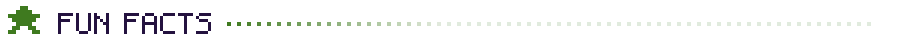
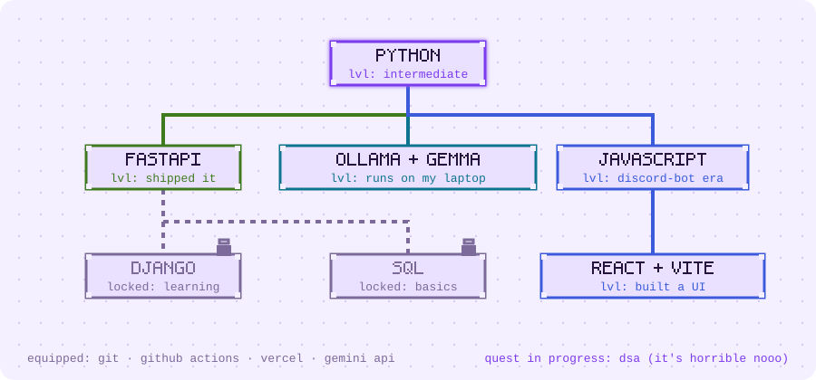
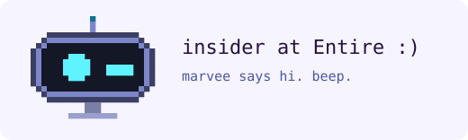

<h1>charan.exe</h1>

<picture>
  <source media="(prefers-color-scheme: dark)" srcset="./assets/hero-dark.svg">
  <source media="(prefers-color-scheme: light)" srcset="./assets/hero-light.svg">
  
</picture>

try it yourself: `npx hello-charan`

beep boop. i'm charan, a computer science student unit. i learn by building things, shipping them in public and fixing them when they inevitably break. **open to internships** in software engineering and AI/ML, remote or on-site.

<details>
<summary>secret: why noah?</summary>

online i also run as Noah Osmont (NoahCodesPython). people kept mispronouncing my name and most of my Discord friends live abroad, so Noah stuck. same robot, two names. why not both?

</details>

<picture>
  <source media="(prefers-color-scheme: dark)" srcset="./assets/divider-dark.svg">
  <source media="(prefers-color-scheme: light)" srcset="./assets/divider-light.svg">
  
</picture>

<h2><picture>
  <source media="(prefers-color-scheme: dark)" srcset="./assets/h-spec-dark.svg">
  <source media="(prefers-color-scheme: light)" srcset="./assets/h-spec-light.svg">
  
</picture></h2>

| Component | Value |
| --- | --- |
| Model | Charan Nihaal R, B.E. CSE student |
| Firmware | Python 3 (main), JavaScript |
| Hardware | one HP Victus laptop that also runs my local AI models |
| Fuel | coffee |
| Known bugs | talks more in text than irl; extreme introvert, working on public speaking |
| Currently | investing time in learning AI tools |
| Community | Insider at Entire :) |
| Long-term goal | build a real, friendly robot one day |

<h2><picture>
  <source media="(prefers-color-scheme: dark)" srcset="./assets/h-fun-dark.svg">
  <source media="(prefers-color-scheme: light)" srcset="./assets/h-fun-light.svg">
  
</picture></h2>

- solves a Rubik's cube in under 2 minutes.
- PC gamer: GTA, NFS and puzzle games like Viewfinder.
- novel addict (web novels like Infinite Mana in the Apocalypse), plus anime, movies and dramas in a bunch of languages.
- dances, cooks a little, and does OSINT and cybersecurity challenges for fun.
- building Discord bots since 2021.

<details>
<summary>🔒 open only if you have coffee</summary>

```text
$ brew coffee --strength=exam-week
[ ok ] coffee brewed
[ ok ] productivity +40%
[warn] sleep schedule not found
```

thanks for sharing your coffee. this robot now owes you one bug fix.

</details>

<picture>
  <source media="(prefers-color-scheme: dark)" srcset="./assets/divider-dark.svg">
  <source media="(prefers-color-scheme: light)" srcset="./assets/divider-light.svg">
  
</picture>

<h2><picture>
  <source media="(prefers-color-scheme: dark)" srcset="./assets/h-proc-dark.svg">
  <source media="(prefers-color-scheme: light)" srcset="./assets/h-proc-light.svg">
  
</picture></h2>

### TrustIntern

A scam detective for internship and job offers. Paste in an offer and TrustIntern checks the company, recruiter, website and message, then gives an explainable risk score. The score is a heuristic indicator, not a probability of fraud.

Built with my teammates Sathya Sai, Dhanush P and Jayaraj R at Hack Day Chennai at VIT Chennai, then polished for the DEV Hacktoberfest Open-Source AI Challenge. Python, FastAPI, React with Vite, Ollama running Gemma, Vercel and GitHub Actions.

- [Try TrustIntern live](https://trustintern.charancodes.com)
- [Read the TrustIntern source code](https://github.com/compteccharan/TrustIntern)
- [Read how I built it in my DEV post](https://dev.to/noahosmont/trustintern-i-built-a-scam-detective-for-internship-offers-in-55-hours-and-my-agents-kept-1446)

### Other processes

- [V2Trello](https://github.com/compteccharan/V2Trello): manage Trello by voice or plain language, with a confirmation step before anything changes. [Try V2Trello live](https://v2trello.charancodes.com).
- [Phish Hook](https://github.com/NoahCodesPython/phish-hook): a TypeScript browser extension that flags phishing pages.
- [Daily Necessities](https://github.com/compteccharan/Daily-Necessities): [try Daily Necessities live](https://compteccharan.github.io/Daily-Necessities/).
- [CloudNine flight booking UI](https://github.com/compteccharan/cloudnine-flight-booking-ui): a responsive booking prototype in HTML, CSS and vanilla JavaScript.
- [Ultimate Discord Bot](https://github.com/compteccharan/Ultimate-Discord-Bot) and [Discord hosting bot](https://github.com/compteccharan/discord-hosting-bot): the JavaScript Discord bots where it all started.

<h2><picture>
  <source media="(prefers-color-scheme: dark)" srcset="./assets/h-log-dark.svg">
  <source media="(prefers-color-scheme: light)" srcset="./assets/h-log-light.svg">
  
</picture></h2>

- **Hacktoberfest 2026 Completionist.**
- **Planetfall:** [my leaderboard duplicate-entry fix with a test suite](https://github.com/blackgirlbytes/planetfall-seed-signalkit/pull/19) was merged into this 3D browser game in June 2026.
- **animated-welcome:** an npm package for Discord welcome GIFs.
- **Entire Insider** in the Entire community.

<h2><picture>
  <source media="(prefers-color-scheme: dark)" srcset="./assets/h-crash-dark.svg">
  <source media="(prefers-color-scheme: light)" srcset="./assets/h-crash-light.svg">
  
</picture></h2>

<details>
<summary>cat crash_log.txt</summary>

- **Aquire:** my Discord bot was verified and in 100+ servers, then died in a Discord manifest update during exam season (whyyy). Rebuilt it in Python.
- **PeriodAllocator:** a substitute-teacher scheduler that ran at my school for about 3 months, until several teachers were absent at once and it broke. Lesson learned.

</details>

<picture>
  <source media="(prefers-color-scheme: dark)" srcset="./assets/divider-dark.svg">
  <source media="(prefers-color-scheme: light)" srcset="./assets/divider-light.svg">
  
</picture>

<h2><picture>
  <source media="(prefers-color-scheme: dark)" srcset="./assets/h-skill-dark.svg">
  <source media="(prefers-color-scheme: light)" srcset="./assets/h-skill-light.svg">
  
</picture></h2>

<picture>
  <source media="(prefers-color-scheme: dark)" srcset="./assets/skilltree-dark.svg">
  <source media="(prefers-color-scheme: light)" srcset="./assets/skilltree-light.svg">
  
</picture>

<details>
<summary>skill tree as text</summary>

| Area | Tools | Level |
| --- | --- | --- |
| Languages | Python (main), JavaScript | Python intermediate |
| Backend | FastAPI | shipped projects |
| Frontend | React, Vite, HTML, CSS | built UIs |
| AI | Ollama with Gemma, the Gemini API, multi-agent workflows | local and hosted |
| Shipping | Git, GitHub Actions, Vercel | daily use |
| Learning | Django, SQL, data structures and algorithms | SQL basics |

</details>

<h2><picture>
  <source media="(prefers-color-scheme: dark)" srcset="./assets/h-tele-dark.svg">
  <source media="(prefers-color-scheme: light)" srcset="./assets/h-tele-light.svg">
  
</picture></h2>

<picture>
  <source media="(prefers-color-scheme: dark)" srcset="https://github-readme-stats.vercel.app/api?username=compteccharan&show_icons=true&theme=tokyonight&hide_border=true">
  
</picture>

<picture>
  <source media="(prefers-color-scheme: dark)" srcset="https://streak-stats.demolab.com?user=compteccharan&theme=tokyonight&hide_border=true">
  
</picture>

<picture>
  <source media="(prefers-color-scheme: dark)" srcset="./assets/divider-dark.svg">
  <source media="(prefers-color-scheme: light)" srcset="./assets/divider-light.svg">
  
</picture>

<p>say hi to marvee:</p>

<picture>
  <source media="(prefers-color-scheme: dark)" srcset="./assets/marvee-dark.svg">
  <source media="(prefers-color-scheme: light)" srcset="./assets/marvee-light.svg">
  
</picture>

<h2><picture>
  <source media="(prefers-color-scheme: dark)" srcset="./assets/h-ping-dark.svg">
  <source media="(prefers-color-scheme: light)" srcset="./assets/h-ping-light.svg">
  
</picture></h2>

- [All my links at charancodes.com](https://charancodes.com)
- [My writing on DEV](https://dev.to/noahosmont)
- [Connect with me on LinkedIn](https://www.linkedin.com/in/charan-nihaal-r-0ba8a7368/)
- [Email me](mailto:charancodes@proton.me)

Found a bug in one of my projects? Open an issue. This robot accepts bug reports and coffee.

<picture>
  <source media="(prefers-color-scheme: dark)" srcset="./assets/footer-dark.svg">
  <source media="(prefers-color-scheme: light)" srcset="./assets/footer-light.svg">
  
</picture>
